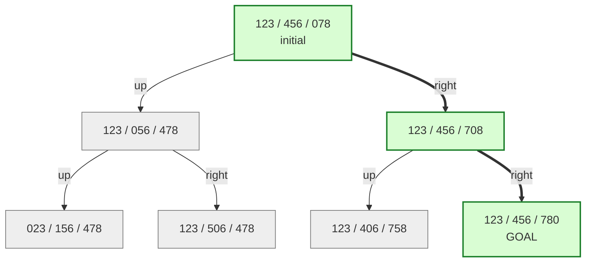
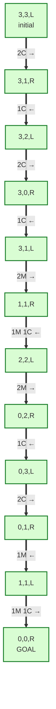
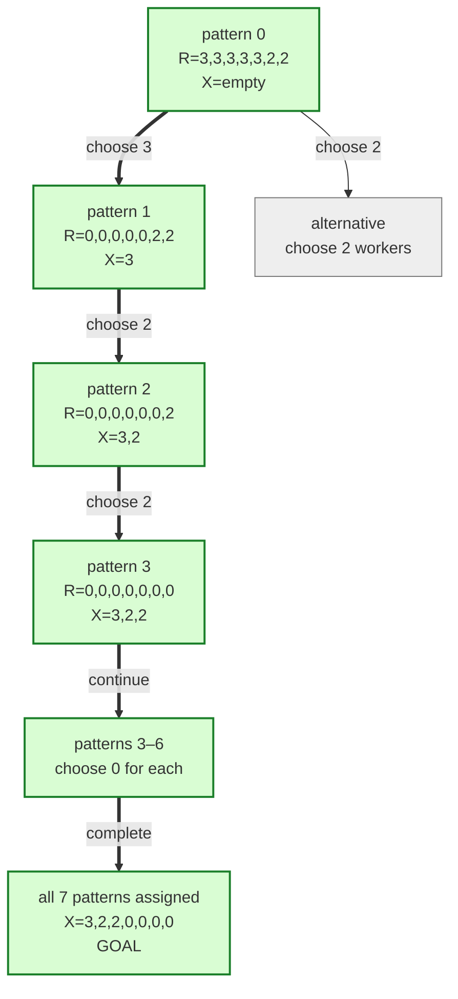

# Artificial Intelligence 2026 — Assignment 1

Complete Python implementation of the four tasks in
[`Detyra1.md`](https://github.com/adrianymeri/Artificial-Intelligence-2026/blob/main/Detyra1.md).
The code uses only the Python standard library.

## Run

Python 3.10 or newer is required.

```bash
python -m ai_coursework.cli golfers --weeks 10
python -m ai_coursework.cli sudoku --level hard
python -m ai_coursework.cli latin 5
python -m ai_coursework.cli puzzle 123456078
python -m ai_coursework.cli missionaries
python -m ai_coursework.cli workforce --demand 3,3,3,3,3,2,2
python -m unittest discover -v
```

## 1. Social Golfers — DFS with backtracking

### Model and representation

- **Instance:** `n = g × p` players, `g` groups, `p` players per group, and `w` weeks.
- **Variable:** `X[w,g,p]`, the player occupying a position in a group in a week.
- **Domain:** player identifiers `0..n-1`.
- **Constraints:** every player occurs exactly once per week; each group has `p`
  distinct players; every unordered pair of players occurs together at most once.
- **Goal test / objective:** minimize repeated pair meetings. The optimum is `0`.

The required `n=32, g=8, p=4` case is a famous and exceptionally difficult search
benchmark. The solver uses the first nine weeks of Aguado's published construction
as a feasible, symmetry-breaking prefix. It does **not** store the final week. DFS
chooses its groups, always anchors the next group with the smallest unassigned
player, and backtracks whenever any pair has occurred in the prefix. The completed
schedule is then independently validated. This keeps the requested DFS behavior
runnable in ordinary Python while being explicit about the seed construction.

### Objective function

For pair `i,j`, let `m(i,j)` be the number of groups in which it occurs:

```text
f(S) = Σ(i<j) max(0, m(i,j) - 1)
```

`f(S)=0` is a valid schedule. The implementation exposes this as `objective`.

### Landscape

One unconstrained weekly partition has

```text
P(n,p) = n! / ((p!)^(n/p) × (n/p)!)
```

possibilities, so the raw `w`-week landscape is `P(n,p)^w`. Constraints and
symmetry reduce the searched part enormously. Pair counting gives the upper bound

```text
w ≤ floor((n-1)/(p-1)).
```

For 32 players in groups of 4 this is `floor(31/3)=10`. The solver constructs a
valid 10-week schedule, so 10 is both achievable and maximal.

## 2. Sudoku — BFS with backtracking/path reconstruction

### Model and representation

- **Variables:** the 81 cells `X[r,c]`.
- **Domain:** `{1,...,9}` for empty cells; a singleton for clues.
- **Constraints:** `AllDifferent` for every row, column, and 3×3 box.
- **State:** an immutable 81-number tuple (`0` means empty).
- **Action:** put one legal value in the empty cell with the fewest candidates.
- **Goal:** no empty cells and all constraints hold.

The frontier is FIFO, therefore branching states are explored breadth-first.
Constraint propagation repeatedly fills forced singletons before a state enters
the frontier. A `parent` map stores the search tree and reconstructs the successful
root-to-goal path (the backtracking/reconstruction component requested in the
assignment). `easy`, `medium`, and `hard` built-in instances are included.

### Objective and landscape

```text
f(B) = number of empty cells + number of row/column duplicate violations
```

The optimum is zero (box consistency is enforced by successor generation too).
With `e` empty cells, the naive landscape is `9^e`. Legal domains, MRV, and
singleton propagation remove most of it.

## 3. Latin Square — IDDFS and backtracking

### Model and representation

- **Variables:** `X[r,c]` in an `n×n` grid.
- **Domain:** `{1,...,n}`.
- **Constraints:** every value appears exactly once in every row and column.
- **State:** the current partial grid and the next empty cell.
- **Action:** assign a value absent from that cell's row and column.

The first row and column are fixed to `1..n`. This is symmetry breaking: any Latin
square can be relabeled/reordered into this reduced form, so it does not change
whether a solution exists. IDDFS runs depth-limited DFS with limits from zero up to
the number of non-fixed cells. Failed assignments are reset to zero (backtracking).

### Objective and landscape

The objective counts missing/distinctness violations across all rows and columns;
zero is optimal. Before constraints, there are `n^(n²)` possible grids. A reduced
search fixes `2n-1` cells and prunes a branch as soon as a row/column repeats.

## 4. Search Trees

`breadth_first_tree` explicitly records each expanded state's children, its parent,
and the generating action. It is reused by all three models.

### 8-Puzzle

- **State:** a 9-tuple containing tiles `0..8`; `0` is the blank.
- **Actions:** move the blank up, down, left, or right when legal.
- **Goal:** `(1,2,3,4,5,6,7,8,0)`.
- **Tree:** repeated configurations are suppressed; BFS returns a shortest path.
- **Safety:** inversion parity rejects unreachable inputs before search.

The following is the BFS tree for the command-line example `123456078`. Each
nine-digit label is read row by row, and `0` is the blank. Green nodes and thick
arrows show the shortest solution branch; gray nodes are explored alternatives.



### Missionaries and Cannibals

- **State:** `(M_left, C_left, boat_side)`.
- **Actions:** transport `(1,0)`, `(2,0)`, `(0,1)`, `(0,2)`, or `(1,1)`.
- **Constraint:** on either bank containing missionaries, cannibals cannot outnumber
  them.
- **Initial/goal:** `(3,3,left)` to `(0,0,right)`. BFS finds the classic 11-crossing
  shortest solution.

This diagram shows the solution branch reconstructed from the BFS parent map.
`(M,C,L/R)` records the missionaries and cannibals on the **left** bank followed
by the boat side. Every omitted branch is either unsafe, a repeated state, or is
another state still waiting in the BFS frontier.



### Rotating Workforce Scheduling

- **Input:** daily minimum demand and repeating binary work/rest rotation patterns.
- **State:** `(next_pattern, remaining_daily_demand, chosen_worker_counts)`.
- **Action:** select how many workers receive the next rotation.
- **Goal:** all patterns have been considered and remaining demand is zero.

The included seven patterns represent five consecutive workdays followed by two
days off, with each possible start day. The resulting explicit tree shows every
staff-count decision and supports a custom seven-day demand vector.

For the default demand `(3,3,3,3,3,2,2)`, one successful branch is below. `R` is
the remaining demand and `X` is the worker count chosen so far. A full tree would
contain every allowed worker count at each level, so the diagram displays the
successful branch and one alternative to make the branching rule visible.



### How to draw these trees by hand

1. Draw the initial state at the top as the root.
2. Generate every legal action in the same order as the program.
3. Draw one child node for each resulting state and label the connecting edge
   with its action.
4. Cross out unsafe states and states already visited; do not expand them again.
5. For BFS, finish the entire current depth before moving down one level.
6. Stop when the goal is removed from the frontier, then highlight its parent
   chain back to the root.

On GitHub the Mermaid blocks render automatically. For a printed submission,
open the repository page, expand the browser window, and print the README to PDF;
the diagrams remain vector-sharp and can then be printed or scanned.

## Project structure

```text
ai_coursework/social_golfers.py  DFS/backtracking and validation
ai_coursework/sudoku.py          BFS, propagation, three levels
ai_coursework/latin_square.py    IDDFS/backtracking
ai_coursework/search_trees.py    generic tree + three applications
ai_coursework/cli.py             runnable demonstrations
tests/test_coursework.py         correctness and edge-case tests
```

